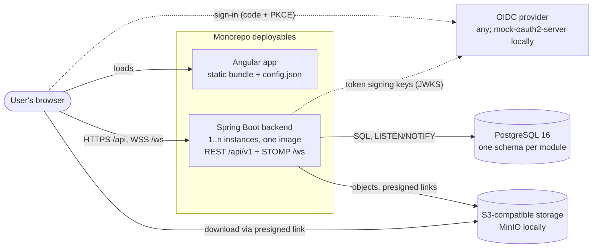
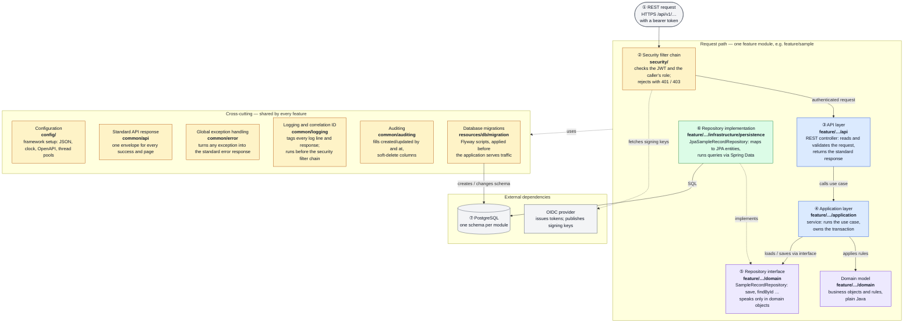
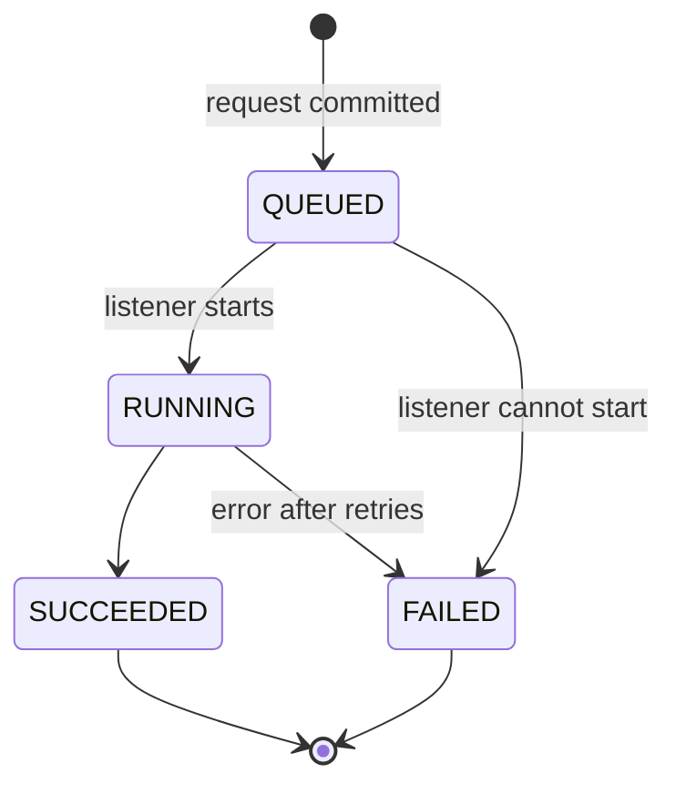
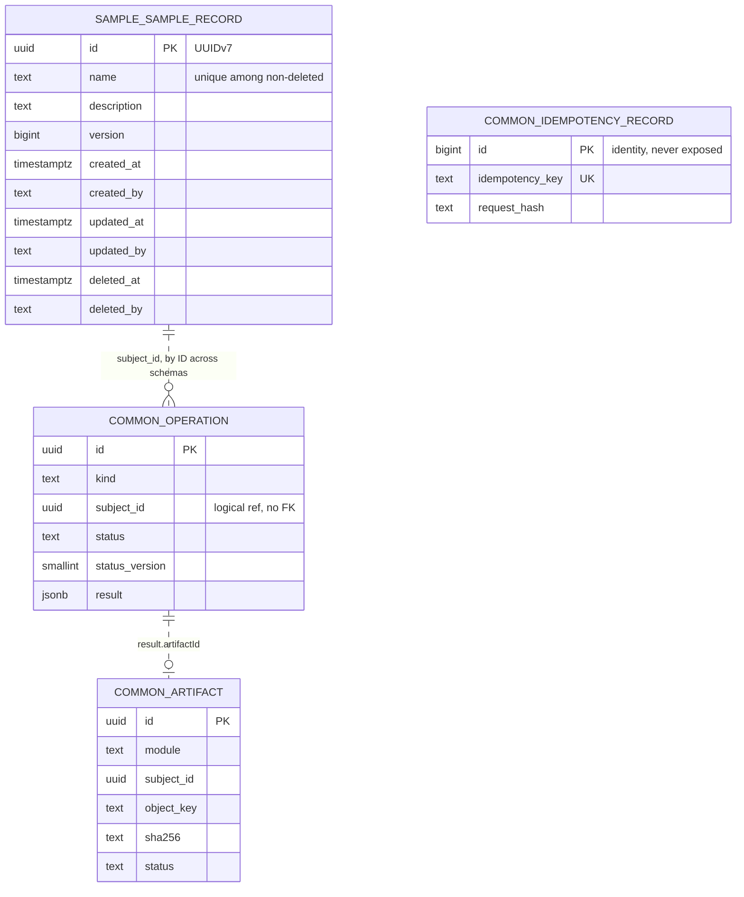

# Architecture diagrams

## 1. System context (runtime)



The backend and frontend build and deploy independently. Locally, `infrastructure/compose.yaml` provides PostgreSQL, MinIO and the mock OIDC provider. Production hosting is out of scope.

## 2. Backend architecture and request flow



**How to read it**
- **Colours:**
  - blue = request-handling layers
  - purple = domain (model and repository interface)
  - green = infrastructure (repository implementation)
  - amber = cross-cutting packages; the security filter chain is one of them, sitting on the request path
  - grey = outside the application
- **Arrows:**
  - Solid arrows are calls or data flow.
  - The dashed "implements" arrow is a compile-time dependency: the implementation depends on the interface, never the reverse.
  - Spring injects the implementation wherever the interface is asked for.
- **The response** goes back the same way. Controllers wrap results in the standard response; any exception becomes the standard error response, carrying the correlation ID.

| # / component | Package | Responsibility |
|---|---|---|
| ① REST request | — | A client call to `/api/v1/…` with a bearer token |
| ② Security filter chain | `security/` | Validate the JWT (signature, issuer, audience, expiry), map roles, deny by default |
| ③ API layer | `feature/<module>/api` | Bind and validate the request, check `@PreAuthorize`, call one service, wrap the result |
| ④ Application layer | `feature/<module>/application` | Run the use case, own the transaction, use domain objects and repository interfaces |
| Domain model | `feature/<module>/domain` | Business objects, invariants and state transitions; no framework code |
| ⑤ Repository interface | `feature/<module>/domain` | Data-access contract for one aggregate, in domain terms |
| ⑥ Repository implementation | `feature/<module>/infrastructure/persistence` | JPA/Spring Data implementation; entity ↔ domain mapping; data access only |
| ⑦ PostgreSQL | external | Stores data; one schema per module |
| Configuration | `config/` | Framework beans and settings |
| Standard API response | `common/api` | `ApiResponse<T>`, paging wrapper |
| Global exception handling | `common/error` | One `@RestControllerAdvice` mapping exceptions to status + error code |
| Logging and correlation ID | `common/logging` | Correlation ID in MDC and response; structured logs; masking |
| Auditing | `common/auditing` | Base entities and `AuditorAware`; soft delete |
| Database migrations | `resources/db/migration` | Versioned Flyway SQL per module |

## 3. Sequence — long-running work with live status (sample export)

```mermaid
sequenceDiagram
  autonumber
  participant C as Browser
  participant A as Backend instance A
  participant B as Backend instance B
  participant DB as PostgreSQL
  participant S3 as Object storage
  C->>A: POST /api/v1/sample-records/export (Bearer, X-Correlation-Id)
  rect rgb(235,245,255)
  note over A,DB: one transaction
  A->>DB: INSERT common.operation (QUEUED, version 1)
  A->>DB: INSERT event_publication (SampleExportRequested)
  end
  A-->>C: 202 envelope {operationId, status: QUEUED}
  C->>B: STOMP SUBSCRIBE /topic/operations/{id}, then /app/operations/{id} (snapshot)
  A->>A: after commit: SampleExportListener (async)
  A->>DB: UPDATE operation → RUNNING, version 2; pg_notify (same tx)
  DB-->>A: NOTIFY
  DB-->>B: NOTIFY
  B-->>C: STOMP MESSAGE {status: RUNNING, version: 2}
  A->>S3: PUT export file (outside any tx)
  A->>DB: artifact STORED; operation → SUCCEEDED, version 3, result {artifactId}; pg_notify
  B-->>C: STOMP MESSAGE {status: SUCCEEDED, version: 3, artifactId}
  C->>A: GET /api/v1/artifacts/{artifactId}/download-url
  C->>S3: GET presigned URL
```

## 4. Operation status state machine



`status_version` only ever increases; clients drop any message whose version is not higher than the last one seen.

## 5. ERD (seed tables)



Dotted lines are references by ID across schemas, with no foreign key. There are no local user or role tables: identities and roles come from the OIDC provider. Audit columns hold the token subject or `system:<name>`. `sample_record` is a demonstration table with no business meaning.
